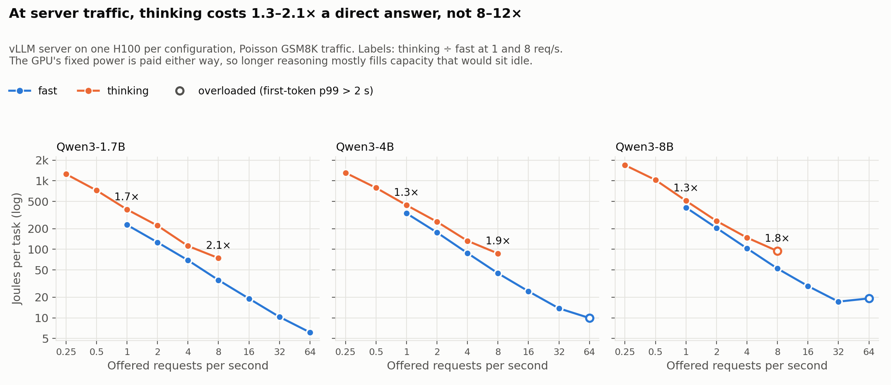

# GreenRoute

An open benchmark for the energy cost of LLM inference — measured per **completed task at a fixed quality bar**, retries included.

> Status: early. Sprints 0–2 are done: the measurement harness works and we have first results on batch size, model size and traffic level. Phase 1 of the benchmark is in progress: Qwen3 models with thinking off and on, GSM8K and HumanEval, and first effort-routing results on GSM8K (offline, at saturation). See [`ROADMAP.md`](ROADMAP.md).

## The question

How many joules does it take an LLM to actually finish a task (solve a GSM8K problem, pass a HumanEval test) at a given quality level — and how much of that can be cut by choosing the right model, quantization, batch size, time, and place to run it?

Most published numbers are per token or estimated from FLOPs. We measure GPU energy directly and aim to report **J/task@Q**: joules per completed task at a fixed quality floor, with every retry and escalation charged to the task.

## Results so far

All numbers are GPU-side joules per task on one NVIDIA H100, GSM8K test set (1,319 problems) unless stated, vLLM 0.10.1.1. "Per task" divides GPU energy, idle floor included, by the number of problems attempted.

### Reasoning effort (Phase 1)

Qwen3 models can answer directly ("fast") or reason first ("thinking"). Offline at saturation, measured at steady state (see [`METHODS.md`](METHODS.md#steady-state)), two runs each ([`20261111-162535`](results/phase1/20261111-162535/summary.csv), [`20261111-163041`](results/phase1/20261111-163041/summary.csv)):

| GSM8K test | Accuracy | Tokens per task | J/task (steady) | J per output token |
| --- | --- | --- | --- | --- |
| Qwen3-1.7B fast | 81.3% | 232 | 5.8 (5.7–5.9) | 0.025 |
| Qwen3-4B fast | 91.1% | 264 | 10.0 (9.9–10.0) | 0.038 |
| Qwen3-8B fast | 93.7% | 261 | 13.0 (12.6–13.3) | 0.050 |
| Qwen3-1.7B thinking | 90.5–91.2% | 1,460 | 68 (65–70) | 0.046 |
| Qwen3-4B thinking | 93.9–94.1% | 1,340 | 82 (81–84) | 0.061 |
| Qwen3-8B thinking | 95.1–95.2% | 1,450 | 113 (113–114) | 0.077 |

- **Thinking costs 8–12x the energy of a direct answer** for 1.5–10 points of accuracy: about 5–6x more tokens, each about 1.6–1.8x dearer because reasoning chains make every step work over a longer context.
- **Whole-run measurement overstates thinking by 1.4–1.9x.** An offline batch ends with a few very long answers running on a mostly empty GPU; a live server would fill those slots. Fast mode is overstated by only 4–15%.
- **Routing effort per question recovers most of the accuracy for less than half the energy.** Answering with the 8B fast and sending the least confident answers to thinking mode, with the confidence threshold set on GSM8K train and applied unchanged to test ([`analysis/phase1_router.py`](analysis/phase1_router.py)):

| GSM8K test, 8B | Escalated to thinking | Accuracy | J/task |
| --- | --- | --- | --- |
| Always fast | 0% | 93.7% | 12.6 |
| Least confident token, low threshold | 4% | 94.2% | 21.8 |
| Least confident token, higher threshold | 24% | 95.1% | 52.6 |
| Always thinking | 100% | 95.1% | 113 |
| Perfect router (bound, not achievable) | 6% | 96.8% | 31.1 |

  The router's numbers are from one run ([`20261111-162535`](results/phase1/20261111-162535)). The gap to the perfect router is the open problem: a cheap signal that knows when the model is wrong.

- **Model family matters.** Phi-4-mini (3.8B) scores 89.8% on GSM8K at 7.4 J/task (whole run), close to Qwen3-4B fast; OLMo-2 7B scores 84.2% at 18.7 J/task ([`20261111-151009`](results/phase1/20261111-151009/summary.csv)).

### Power curves: effort under server traffic (Phase 1)

The numbers above are at saturation. A vLLM server under Poisson traffic, one H100 per configuration, with energy measured over each level's steady window ([`20261111-172237`](results/phase1_power/20261111-172237/summary.csv), one run, provisional), shows the fixed cost of a running GPU dominating:

| Fitted power curve | Idle | Floor while serving | Extra energy per output token |
| --- | --- | --- | --- |
| Qwen3-1.7B fast | 124 W | 241 W | 10.7 mJ |
| Qwen3-4B fast | 136 W | 315 W | 15.5 mJ |
| Qwen3-8B fast | 124 W | 366 W | 24.0 mJ |
| Qwen3 1.7B / 4B / 8B thinking | 116–126 W | 263–358 W | 25.6–27.4 mJ |

- **The floor is most of the bill.** The 8B fast at 30 req/s draws 546 W, of which the tokens account for about 200 W.
- **At server traffic, thinking costs 1.3–2.1x a direct answer, not 8–12x.** For the 8B at 1 req/s, 511 J vs 408 J per task (1.25x); at 8 req/s, 94 J vs 52 J (1.8x). The floor is paid either way, so longer reasoning mostly fills capacity that would sit idle. The gap widens as the GPU fills.
- **On the 8B, a thinking token costs the same as a direct one at equal throughput** (0.068 vs 0.066 J at about 8,240 tokens/s). Thinking is dearer because it is longer.
- **For routing, the price of escalation depends on load:** cheap on a quiet GPU, close to the offline 8–12x on a full one. A router's confidence threshold should move with traffic.
- **Agrees with Sprint 2:** the 1.7B fast at 1 and 32 req/s gives 227 and 10.3 J/task, against 228 and 10.4.



### Load (Sprints 1–2)

**How busy the GPU is matters far more than which model runs on it.** Under open-loop Poisson traffic to a vLLM server ([Sprint 2](results/sprint2/20261111-125043/summary.csv)):

| J/task | 1 req/s | 8 req/s | 32 req/s | 64 req/s | burst | Accuracy (same 100 problems) |
| --- | --- | --- | --- | --- | --- | --- |
| Qwen3-1.7B | 228 | 35.0 | 10.4 | 6.8 | 5.3 | 84–88% |
| Qwen3-8B | 417 | 54.4 | 18.6 | 15.3 | 14.0 | 96–98% |

- Energy per task falls about 43x (1.7B) and 30x (8B) from 1 req/s to saturation. An H100 with a model loaded draws about 120 W doing nothing, and that floor is spread over however many tasks arrive.
- At the same request rate the 8B costs 1.6–2.6x the 1.7B. Load swamps that: the 8B at 32 req/s is cheaper per task than the 1.7B at 8 req/s.
- Accuracy does not change with load.
- First-token latency (p99) stays under 0.1 s through 64 req/s for the 1.7B and through 32 req/s for the 8B, so most of the saving from running hotter costs no latency.


The chart is from a repeat of the same sweep ([`20261111-123849`](results/sprint2/20261111-123849/summary.csv)), so its labels differ from the table by a few percent.

**Offline batch runs agree** ([Sprint 1](results/sprint1/20261111-113649/summary.csv), full 1,319-problem test set):

| Qwen3-1.7B, concurrency cap | 1 | 8 | 32 | 128 | 256 |
| --- | --- | --- | --- | --- | --- |
| J/task | 220 | 30.5 | 11.3–13.4 | 6.4 | 5.4 |

| At concurrency 32 | Qwen3-1.7B | Qwen3-4B | Qwen3-8B |
| --- | --- | --- | --- |
| Accuracy | 80.5–81.8% | 91.5% | 93.6% |
| J/task | 11.3–13.4 | 24.1 | 34.0 |

### What these numbers do not show

- **Routing is measured offline only.** The effort-routing numbers combine per-problem results from separate runs at saturation; no live router has been run, and at low traffic the GPU's fixed power floor changes the picture.
- **Noise.** In Phase 1, accuracy moves under 1 point between runs and steady-state energy 1–8%. In the Sprint 1–2 numbers, which are whole-run, identical configurations differ by up to about 18% in J/task. Greedy decoding still changes the answer on 1–5% of individual problems between runs.
- **The power curves are one provisional run.** Thinking was only run up to 8 req/s, so there is no saturated thinking point from the server; the lowest-rate thinking levels have 22–45 problems each; and power rises gradually at low load, so the straight-line fit overstates it there (for the 1.7B at 1 req/s, 243 W fitted against 197 W measured). Per-level numbers are measured; the fit is a summary.
- **HumanEval energy is not yet at saturation.** Its 164 problems cannot fill the GPU, so its energy figures are higher than a busy server's and have no steady-state value.
- **Narrow scope.** Two tasks, one GPU type, five models from three families, GPU energy only (no host CPU, memory or cooling).
- **The top of the traffic range is rough.** The 64 req/s and burst levels last about 10 seconds, and the 1.7B's burst appears to be limited by the vLLM API server, not the GPU.
- **The first Sprint 2 sweep is superseded.** [`results/sprint2/20261111-122048`](results/sprint2/20261111-122048) was limited by a single-process load generator above about 33 req/s; it is kept for the record.
- **Known effect.** That batching and utilization drive energy per request is established in prior work. These runs validate the harness; the new contribution is meant to be the quality-matched comparison.

## What's here

| Path | What |
| --- | --- |
| [`METHODS.md`](METHODS.md) | How we measure. Read this first if you want to review the work. |
| [`ROADMAP.md`](ROADMAP.md) | The benchmark and router plan, phase by phase. |
| [`CONTRIBUTING.md`](CONTRIBUTING.md) | How to help, and how credit works. |
| `greenroute/` | Energy meter, GSM8K scoring, offline benchmark, load generator and server benchmark. |
| `experiments/` | One Modal entry point per sprint. |
| `analysis/` | Scripts that turn a results folder into charts and fits. |
| `results/` | Raw per-problem logs, summaries and charts for every run. |

## Run it

Needs Python 3.10+ and a [Modal](https://modal.com) account. The GPU runs cost money on your Modal account.

```bash
uv venv --python 3.10 .venv && source .venv/bin/activate
uv pip install -e ".[dev]"
modal setup                      # one-time browser login
pytest -q                        # local unit tests, no GPU needed
```

```bash
modal run experiments/sprint0.py # one model, 100 problems: first J/task number
modal run experiments/sprint1.py # repeats, batch-size sweep, model sizes (full test set)
modal run experiments/sprint2.py # server under Poisson traffic: latency vs energy
modal run experiments/phase1.py  # per-problem table: Qwen3 sizes x thinking x GSM8K/HumanEval
modal run experiments/phase1_power.py  # power curves: server sweeps, Qwen3 sizes x fast/thinking
```

Each script's docstring lists its options. Pick the GPU with `GREENROUTE_GPU` (default H100; Sprint 0 defaults to A100-80GB) and Sprint 2's CPU count with `GREENROUTE_CPUS` (default 16). Every run writes JSON with the config, the exact command, the git commit and per-problem records. A commit hash ending in `-dirty` means the code that produced the result was not committed.

## Roadmap

- **Sprint 0 (done)** — one small model served with vLLM, GPU energy instrumented, first J/task number logged.
- **Sprint 1 (done)** — repeats, batch-size sweep and three model sizes on the full GSM8K test set. Quantization was planned here and is deferred.
- **Sprint 2 (done)** — latency vs energy for a real server under open-loop traffic, with GPU telemetry.
- **Phase 1 (in progress)** — open-model ground truth: Qwen3 sizes with thinking off and on, GSM8K and HumanEval, per-problem correctness, tokens and confidence. The benchmark's measured core and the router's training data.
- **Phase 2** — closed models: accuracy and tokens per solved task measured through their APIs, energy estimated with an estimator validated on open models.
- **Phase 3** — from GPU joules to the grid: server and data-centre overhead, emissions by location and hour, and how much work can shift in time.
- **Phase 4** — the serving framework and router, checked against live measured runs.

- **The product** — a model gateway that routes every request for energy, latency and throughput together at a chosen accuracy, with an energy receipt on every response.

Details and reasoning, including the product vision, are in [`ROADMAP.md`](ROADMAP.md).

## Help wanted

Reviews of the measurement method are the most useful thing right now. See [`CONTRIBUTING.md`](CONTRIBUTING.md).

## License

[Apache-2.0](LICENSE)
