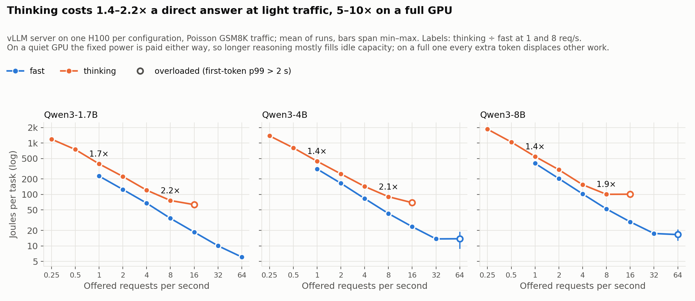
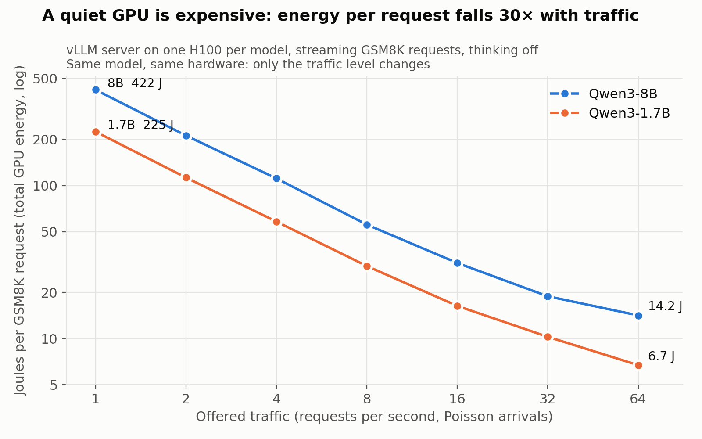

# GreenRoute

An open benchmark for the energy cost of LLM inference — measured per **completed task at a fixed quality bar**, retries included.

> Status: early. Sprints 0–2 are done: the measurement harness works and we have first results on batch size, model size and traffic level. Phase 1 of the benchmark is done: Qwen3 models with thinking off and on and gpt-oss 20b/120b at three reasoning efforts, on GSM8K and HumanEval at saturation, power curves against traffic for each, and first effort-routing results on GSM8K (offline). Phase 2 (closed models) is next. See [`ROADMAP.md`](ROADMAP.md).

## The question

How many joules does it take an LLM to actually finish a task (solve a GSM8K problem, pass a HumanEval test) at a given quality level — and how much of that can be cut by choosing the right model, quantization, batch size, time, and place to run it?

Most published numbers are per token or estimated from FLOPs. We measure GPU energy directly and aim to report **J/task@Q**: joules per completed task at a fixed quality floor, with every retry and escalation charged to the task.

## Results so far

All numbers are GPU-side joules per task on one NVIDIA H100, GSM8K test set (1,319 problems) unless stated, vLLM 0.10.1.1. "Per task" divides GPU energy, idle floor included, by the number of problems attempted.

### Reasoning effort (Phase 1)

Qwen3 models can answer directly ("fast") or reason first ("thinking"). Offline at saturation, measured at steady state (see [`METHODS.md`](METHODS.md#steady-state)), two to four runs each ([`20261111-162535`](results/phase1/20261111-162535/summary.csv), [`20261111-163041`](results/phase1/20261111-163041/summary.csv), [`20261111-180139`](results/phase1/20261111-180139/summary.csv)):

| GSM8K test | Accuracy | Tokens per task | J/task (steady) | J per output token |
| --- | --- | --- | --- | --- |
| Qwen3-1.7B fast | 81.3% | 232 | 6.1 (5.7–6.5) | 0.026 |
| Qwen3-4B fast | 91.1% | 264 | 10.0 (9.9–10.0) | 0.038 |
| Qwen3-8B fast | 93.7% | 261 | 13.0 (12.6–13.3) | 0.050 |
| Qwen3-1.7B thinking | 90.5–91.2% | 1,460 | 68 (65–70) | 0.046 |
| Qwen3-4B thinking | 93.9–94.1% | 1,340 | 82 (81–84) | 0.061 |
| Qwen3-8B thinking | 95.1–95.2% | 1,450 | 113 (113–114) | 0.077 |

- **On a full GPU, thinking costs 8–11x the energy of a direct answer** for 1.5–10 points of accuracy: about 5–6x more tokens, each about 1.6–1.8x dearer because reasoning chains make every step work over a longer context.
- **Whole-run measurement overstates thinking by 1.4–1.9x.** An offline batch ends with a few very long answers running on a mostly empty GPU; a live server would fill those slots. Fast mode is overstated by only 4–15%.
- **Routing effort per question recovers most of the accuracy for less than half the energy.** Answering with the 8B fast and sending the least confident answers to thinking mode, with the confidence threshold set on GSM8K train and applied unchanged to test ([`analysis/phase1_router.py`](analysis/phase1_router.py)):

| GSM8K test, 8B | Escalated to thinking | Accuracy | J/task |
| --- | --- | --- | --- |
| Always fast | 0% | 93.7% | 12.6 |
| Least confident token, low threshold | 4% | 94.2% | 21.8 |
| Least confident token, higher threshold | 24% | 95.1% | 52.6 |
| Always thinking | 100% | 95.1% | 113 |
| Perfect router (bound, not achievable) | 6% | 96.8% | 31.1 |

  The router's numbers are from one run ([`20261111-162535`](results/phase1/20261111-162535)). The gap to the perfect router is the open problem: a cheap signal that knows when the model is wrong.

- **A self-consistency check costs about 4.5x the answer.** Four extra sampled answers per problem, measured at steady state, cost 28, 43 and 59 J per problem for the 1.7B, 4B and 8B fast, against 6–13 J for the answer itself.

**HumanEval at saturation.** Its 164 problems cannot fill 256 batch slots, so each configuration runs the set 8 times in one batch (1,312 requests) to reach a steady state; one run ([`20261111-180139`](results/phase1/20261111-180139/summary.csv)):

| HumanEval | Pass rate | Tokens per task | J/task (steady) | J per output token |
| --- | --- | --- | --- | --- |
| Qwen3-1.7B fast | 70.7% | 207 | 5.2 | 0.025 |
| Qwen3-4B fast | 79.3% | 220 | 7.5 | 0.034 |
| Qwen3-8B fast | 86.1% | 218 | 10.4 | 0.048 |
| Qwen3-1.7B thinking | 81.1% | 3,650 | 425 | 0.117 |
| Qwen3-4B thinking | 87.7% | 3,930 | 742 | 0.189 |
| Qwen3-8B thinking | 88.0% | 3,900 | 827 | 0.212 |

- **On code, thinking costs 70–100x a direct answer** for 2–10 points: about 18x more tokens, each 4–5x dearer. Answers this long (6–10% hit the 15,000-token limit) most likely overflow the GPU's KV cache, which holds about 395k tokens against roughly 930k for 256 such answers, so fewer requests run at once.
- **The 8B fast passes 86.1% at 10.4 J; the 8B thinking 88.0% at 827 J.** On HumanEval, effort routing has far less accuracy to recover than on GSM8K and far more energy to spend.
- Pass rates match the earlier single-copy runs within 2 points, and the 8 copies agree within 1–5 points.

- **Model family matters.** Phi-4-mini (3.8B) scores 89.8% on GSM8K at 7.4 J/task (whole run), close to Qwen3-4B fast; OLMo-2 7B scores 84.2% at 18.7 J/task ([`20261111-151009`](results/phase1/20261111-151009/summary.csv)).

### gpt-oss: reasoning effort on mixture-of-experts models (Phase 1)

gpt-oss always reasons, at low, medium or high effort. Both sizes are mixture-of-experts models: each token uses a few of many expert blocks (about 3.6B of 21B parameters for the 20b, 5.1B of 117B for the 120b). Offline at saturation, one H100 per configuration, measured at steady state, HumanEval as 8 copies; one run each ([`20261111-223452`](results/phase1/20261111-223452/summary.csv)):

| | GSM8K | Tokens | J/task | HumanEval | Tokens | J/task |
| --- | --- | --- | --- | --- | --- | --- |
| gpt-oss-20b low | 94.5% | 249 | 12.8 | 92.5% | 276 | 13.3 |
| gpt-oss-20b medium | 95.8% | 526 | 25.4 | 96.2% | 741 | 36.7 |
| gpt-oss-20b high | 96.1% | 1,128 | 60.1 | 95.8% | 2,618 | 145 |
| gpt-oss-120b low | 95.7% | 249 | 31.6 | 95.3% | 335 | 59.3 |
| gpt-oss-120b medium | 95.7% | 368 | 43.8 | 97.0% | 559 | 110 |
| gpt-oss-120b high | 96.9% | 786 | 162 | 97.7% | 1,780 | 575 |

- **gpt-oss-20b at low effort is the most efficient configuration measured so far.** On HumanEval it passes 92.5% at 13.3 J, against 86.1% at 10.4 J for Qwen3-8B fast and 88.0% at 827 J for Qwen3-8B thinking. Each output token costs about 0.05 J at every effort, the same as the dense Qwen3-8B, although the 20b has 21B parameters in all.
- **More effort buys little.** From low to high costs 4.7–11x the energy for 1.2–3.3 points. On HumanEval the 20b at high effort scores below medium, with 37 of 1,312 answers hitting the token limit.
- **The 120b is cramped on one H100.** Its weights leave little memory for the KV cache, so fewer requests run at once: each token costs 0.12–0.32 J, rising with answer length, and server throughput tops out near 5,000 tokens/s against about 11,000 for the 20b. These are one-GPU numbers, not the model's best case.
- **Load moves the price of effort here too.** High ÷ low effort, energy per GSM8K task: 1.8x (20b) and 1.6x (120b) at 1 req/s on a server ([`20261111-223454`](results/phase1_power/20261111-223454/summary.csv)), 4.7x and 5.1x on a full GPU offline.
- **Greedy decoding breaks high effort.** gpt-oss runs with OpenAI's recommended sampling (temperature 1.0), seeded per request so runs repeat; Qwen3 stays greedy. In a greedy smoke test, about 1 in 10 high-effort answers looped until the 15,000-token limit, holding 55% of all tokens, and the 20b passed 59% of a 32-problem HumanEval slice against 97% sampled ([greedy](results/phase1/20261111-220859/summary.csv), [sampled](results/phase1/20261111-222841/summary.csv)).

### Power curves: effort under server traffic (Phase 1)

The numbers above are at saturation. A vLLM server under Poisson GSM8K traffic, one H100 per configuration, energy measured over each level's steady window, two runs of each sweep ([`20261111-180139`](results/phase1_power/20261111-180139/summary.csv)), shows the fixed cost of a running GPU dominating:

| Fitted power curve (range over 2 runs) | Idle | Floor while serving | Extra energy per output token |
| --- | --- | --- | --- |
| Qwen3-1.7B fast | 129–131 W | 225–246 W | 10.4–10.9 mJ |
| Qwen3-4B fast | 120–121 W | 286–308 W | 15.1–17.1 mJ |
| Qwen3-8B fast | 121–122 W | 360–371 W | 22.5–23.6 mJ |
| Qwen3-1.7B thinking | 123–127 W | 263–270 W | 25.0–27.3 mJ |
| Qwen3-4B thinking | 130 W | 302–313 W | 27.4–29.0 mJ |
| Qwen3-8B thinking | 124–127 W | 379–386 W | 29.1–31.0 mJ |

- **The floor is most of the bill.** The 8B fast at 32 req/s draws 543–561 W, of which the tokens account for about 190 W.
- **How much thinking costs depends on load.** Thinking ÷ fast, energy per task at the same request rate:

| | 1 req/s | 8 req/s | Full GPU |
| --- | --- | --- | --- |
| Qwen3-1.7B | 1.7x | 2.2x | 10x |
| Qwen3-4B | 1.4x | 2.1x | 5x |
| Qwen3-8B | 1.4x | 1.9x | 6x |

  On a quiet GPU the floor is paid either way, so longer reasoning mostly fills capacity that would sit idle. On a full one every extra token displaces other work. ("Full GPU" compares thinking at 16 req/s, where its queue grows, with the busiest fast level the server kept up with.)
- **For routing, the price of escalation moves with traffic,** from under 2x on a quiet GPU to 5–10x on a full one. A router's confidence threshold should move with it.
- **A thinking token costs about 10% more than a direct one at equal throughput** (8B: 0.074–0.075 vs 0.066–0.068 J at about 8,500 tokens/s). Thinking is dearer mostly because it is longer.
- **Server and offline measurements agree.** Thinking at 16 req/s costs 63, 69 and 101 J/task (1.7B, 4B, 8B), 7–16% below the offline steady-state 68, 82 and 113 J. The 1.7B fast at 1 and 32 req/s costs 228 and 10.1 J/task, against Sprint 2's 228 and 10.4.



An earlier single run ([`20261111-172237`](results/phase1_power/20261111-172237/summary.csv)) stopped thinking at 8 req/s; it agrees within a few percent and is kept for the record.

### Load (Sprints 1–2)

**How busy the GPU is matters far more than which model runs on it.** Under open-loop Poisson traffic to a vLLM server ([Sprint 2](results/sprint2/20261111-125043/summary.csv)):

| J/task | 1 req/s | 8 req/s | 32 req/s | 64 req/s | burst | Accuracy (same 100 problems) |
| --- | --- | --- | --- | --- | --- | --- |
| Qwen3-1.7B | 228 | 35.0 | 10.4 | 6.8 | 5.3 | 84–88% |
| Qwen3-8B | 417 | 54.4 | 18.6 | 15.3 | 14.0 | 96–98% |

- Energy per task falls about 43x (1.7B) and 30x (8B) from 1 req/s to saturation. An H100 with a model loaded draws about 120 W doing nothing, and that floor is spread over however many tasks arrive.
- At the same request rate the 8B costs 1.6–2.6x the 1.7B. Load swamps that: the 8B at 32 req/s is cheaper per task than the 1.7B at 8 req/s.
- Accuracy does not change with load.
- First-token latency (p99) stays under 0.1 s through 64 req/s for the 1.7B and through 32 req/s for the 8B, so most of the saving from running hotter costs no latency.



The chart is from a repeat of the same sweep ([`20261111-123849`](results/sprint2/20261111-123849/summary.csv)), so its labels differ from the table by a few percent.

**Offline batch runs agree** ([Sprint 1](results/sprint1/20261111-113649/summary.csv), full 1,319-problem test set):

| Qwen3-1.7B, concurrency cap | 1 | 8 | 32 | 128 | 256 |
| --- | --- | --- | --- | --- | --- |
| J/task | 220 | 30.5 | 11.3–13.4 | 6.4 | 5.4 |

| At concurrency 32 | Qwen3-1.7B | Qwen3-4B | Qwen3-8B |
| --- | --- | --- | --- |
| Accuracy | 80.5–81.8% | 91.5% | 93.6% |
| J/task | 11.3–13.4 | 24.1 | 34.0 |

### What these numbers do not show

- **Routing is measured offline only.** The effort-routing numbers combine per-problem results from separate runs at saturation; no live router has been run, and at low traffic the GPU's fixed power floor changes the picture.
- **Noise.** In Phase 1, accuracy moves under 1 point between runs and steady-state energy 1–12%. In the Sprint 1–2 numbers, which are whole-run, identical configurations differ by up to about 18% in J/task. Greedy decoding still changes the answer on 1–5% of individual problems between runs.
- **The power-curve fit is a summary, not a model.** Power rises gradually at low load, so the straight-line fit overstates it there (for the 1.7B fast at 1 req/s, about 245 W fitted against 200 W measured). Per-level numbers are measured. The lowest-rate thinking levels have 22–45 problems each, and overloaded levels (64 req/s for the 4B and 8B fast) differ by up to 2x between runs; they are left out of the fit.
- **HumanEval at saturation reruns the same problems.** Identical prompts share vLLM's prefix cache, so their prefill is slightly cheaper than unique prompts' would be; decode, most of the energy, is unaffected. It is one run.
- **Narrow scope.** Two tasks, one GPU type, seven models from four families, GPU energy only (no host CPU, memory or cooling). gpt-oss figures are one run each, and the 120b is measured on one GPU only.
- **The power-curve fit does not suit gpt-oss.** Its power rises steeply at light traffic and then levels off near 500–650 W, so the straight line fits poorly (R² 0.62–0.77, against Qwen3's much tighter fits). Its fitted parameters are not reported until a curved model is validated; the per-level numbers are measured.
- **The top of the traffic range is rough.** The 64 req/s and burst levels last about 10 seconds, and the 1.7B's burst appears to be limited by the vLLM API server, not the GPU.
- **The first Sprint 2 sweep is superseded.** [`results/sprint2/20261111-122048`](results/sprint2/20261111-122048) was limited by a single-process load generator above about 33 req/s; it is kept for the record.
- **Known effect.** That batching and utilization drive energy per request is established in prior work. These runs validate the harness; the new contribution is meant to be the quality-matched comparison.

## What's here

| Path | What |
| --- | --- |
| [`METHODS.md`](METHODS.md) | How we measure. Read this first if you want to review the work. |
| [`ROADMAP.md`](ROADMAP.md) | The benchmark and router plan, phase by phase. |
| [`CONTRIBUTING.md`](CONTRIBUTING.md) | How to help, and how credit works. |
| `greenroute/` | Energy meter, GSM8K scoring, offline benchmark, load generator and server benchmark. |
| `experiments/` | One Modal entry point per sprint. |
| `analysis/` | Scripts that turn a results folder into charts and fits. |
| `results/` | Raw per-problem logs, summaries and charts for every run. |

## Run it

Needs Python 3.10+ and a [Modal](https://modal.com) account. The GPU runs cost money on your Modal account.

```bash
uv venv --python 3.10 .venv && source .venv/bin/activate
uv pip install -e ".[dev]"
modal setup                      # one-time browser login
pytest -q                        # local unit tests, no GPU needed
```

```bash
modal run experiments/sprint0.py # one model, 100 problems: first J/task number
modal run experiments/sprint1.py # repeats, batch-size sweep, model sizes (full test set)
modal run experiments/sprint2.py # server under Poisson traffic: latency vs energy
modal run experiments/phase1.py  # per-problem table: Qwen3 sizes x thinking x GSM8K/HumanEval
modal run experiments/phase1_power.py  # power curves: server sweeps, Qwen3 sizes x fast/thinking
modal run experiments/phase1.py --suites gptoss,gptoss_saturate  # gpt-oss 20b/120b x low/medium/high
modal run experiments/phase1_power.py --suite gptoss            # gpt-oss power curves
```

Each script's docstring lists its options. Pick the GPU with `GREENROUTE_GPU` (default H100; Sprint 0 defaults to A100-80GB) and Sprint 2's CPU count with `GREENROUTE_CPUS` (default 16). Every run writes JSON with the config, the exact command, the git commit and per-problem records. A commit hash ending in `-dirty` means the code that produced the result was not committed.

## Roadmap

- **Sprint 0 (done)** — one small model served with vLLM, GPU energy instrumented, first J/task number logged.
- **Sprint 1 (done)** — repeats, batch-size sweep and three model sizes on the full GSM8K test set. Quantization was planned here and is deferred.
- **Sprint 2 (done)** — latency vs energy for a real server under open-loop traffic, with GPU telemetry.
- **Phase 1 (done)** — open-model ground truth: Qwen3 sizes with thinking off and on and gpt-oss at three reasoning efforts, GSM8K and HumanEval, per-problem correctness, tokens and confidence, and a power curve per model and mode. The benchmark's measured core and the router's training data.
- **Phase 2** — closed models: accuracy and tokens per solved task measured through their APIs, energy estimated with an estimator validated on open models.
- **Phase 3** — from GPU joules to the grid: server and data-centre overhead, emissions by location and hour, and how much work can shift in time.
- **Phase 4** — the serving framework and router, checked against live measured runs.

- **The product** — a model gateway that routes every request for energy, latency and throughput together at a chosen accuracy, with an energy receipt on every response.

Details and reasoning, including the product vision, are in [`ROADMAP.md`](ROADMAP.md).

## Help wanted

Reviews of the measurement method are the most useful thing right now. See [`CONTRIBUTING.md`](CONTRIBUTING.md).

## License

[Apache-2.0](LICENSE)
